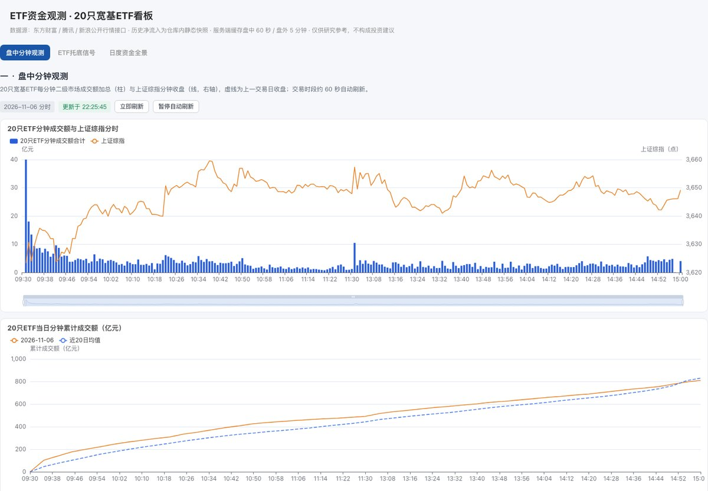
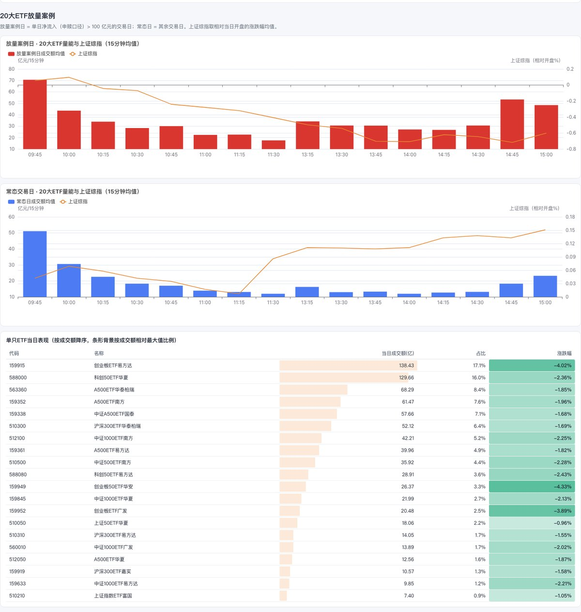
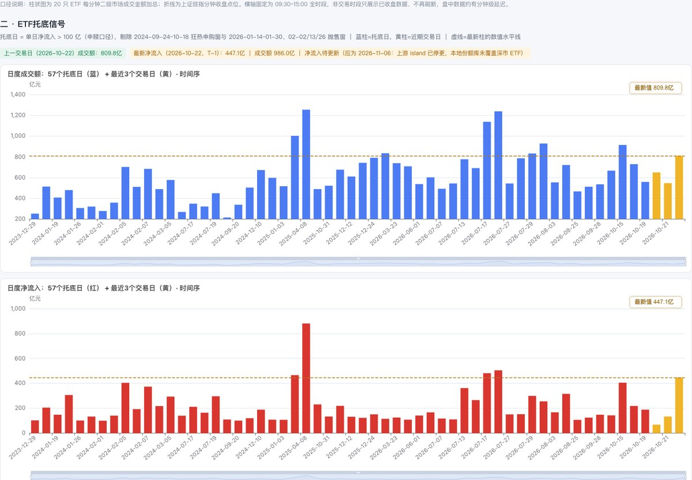
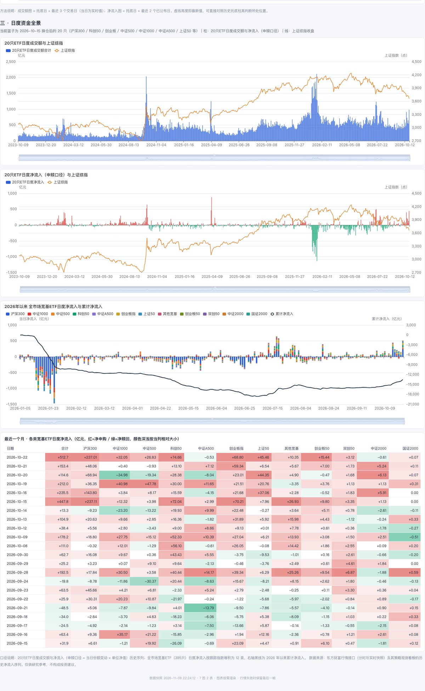

# ETF 资金观测看板（独立开源版）

20 只重点宽基 ETF 的资金观测看板：盘中分钟量能、ETF 托底信号、日度资金全景，7 图 2 表，红涨绿跌。

<p align="center">
  
</p>

> 完整交互请 clone 后运行 `python app.py`，浏览器打开 `http://127.0.0.1:8000`。

这个仓库是**从主站里单独剥出来的一个页面**：只有 Flask + requests 两个依赖，没有数据库、Redis、站内模块、账号体系，clone 下来一条命令就能跑。历史净流入快照随仓库自带，不配置任何外部服务也能出图。

---

## 效果预览

> 截图取自 **2026-11-08 22:24** 生成的静态快照，行情为 **2026-11-06（最近交易日）** 收盘数据；仅作展示，不代表实时行情。完整交互请运行 `app.py`。

**一 · 盘中分钟观测** — 放量案例日 / 常态日的 15 分钟量能对照，以及 20 只 ETF 当日成交额与涨跌幅（红涨绿跌）。



**二 · ETF 托底信号** — 历史托底日的成交额、净流入与最近交易日对照，虚线即最新值水平线。



**三 · 日度资金全景** — 2023-10 以来的日度成交额 / 净流入、12 类宽基 ETF 堆积图，以及最近一个月分类净流入表（红=净申购、绿=净赎回）。



<details>
<summary>如何重新生成这些截图</summary>

1. `python scripts/make_snapshot.py /tmp/snapshot.html` 生成单文件快照（内联一帧 board + bundle）。
2. 去掉快照顶部的橙色横幅（或直接 `python app.py` 起服务），用无头 Chrome 截整页长图：
   `chrome --headless=new --disable-gpu --window-size=1440,6800 --virtual-time-budget=12000 --screenshot=/tmp/full.png file:///tmp/snapshot.html`
3. 按 y 区间 `0–1000 / 1035–2550 / 2550–3550 / 3550–5890` 裁剪，等比缩到 1200 宽、转 JPEG（quality 86），放回 `docs/screenshots/`。

</details>

---

## 为什么能剥离

主站 `/etf_flow` 的依赖其实只有四层，其中数据层（约 1450 行）本来就是纯 Python，只依赖 `requests` + 标准库：

| 层 | 主站位置 | 开源版处理 |
| --- | --- | --- |
| 页面模板 | `service/templates/etf_flow.html`（Jinja2） | 静态化成 `templates/index.html`，去掉站内顶栏 / 子导航 / `static_versioned` |
| 前端 | 3 个 JS + 2 个 CSS + ECharts | 原样拷入 `static/`，一行未改 |
| API | `service/apis/v1/etf_flow_api.py`（flask-restx + 站点限流 + 埋点） | 重写为 `app.py` 纯 Flask blueprint，约 330 行，内置零依赖限流 |
| 数据层 | `service/etf_flow_{board_data,cache,cum}.py` | 原样拷入 `etf_flow/`，仅把上游地址 / 缓存路径改成环境变量 |
| 数据 | `service/data/etf_flow_seed.json`（64 KB） | 随仓库分发，作为完全离线的兜底 |

**关键改动只有三处**：外部看板地址改为可选（默认关闭）、站内限流/埋点移除、Jinja2 模板静态化。前端渲染脚本（`etf_flow_board.js`）通过装载器在 `fetch` 层把 22 个 `/api/kline`、`/api/hq` 请求收口到单个 `/v1/etf_flow/bundle`，所以前端不需要改任何代码就能换后端。

## 快速开始

```bash
python -m venv .venv && source .venv/bin/activate
pip install -r requirements.txt
python app.py
# 打开 http://127.0.0.1:8000
```

Docker：

```bash
docker build -t etf-flow-board .
docker run --rm -p 8000:8000 etf-flow-board
```

可选配置见 `.env.example`（`cp .env.example .env`）。常用：

| 变量 | 默认 | 说明 |
| --- | --- | --- |
| `PORT` / `HOST` | `8000` / `127.0.0.1` | 监听地址；Docker 内已由 gunicorn 绑定 `0.0.0.0` |
| `ETF_BOARD_ORIGIN` | 空 | 接入自己的历史看板（需提供 `/data.js`、`/api/kline`、`/api/hq`） |
| `ETF_RATE_LIMIT_PER_MIN` | `120` | 每 IP 每分钟 `/v1/` 请求上限，`0` 关闭 |
| `ETF_TRUST_ENV` | `0` | 需要走系统代理时设 `1` |
| `ETF_CUM_CACHE` / `ETF_BUNDLE_CACHE` | 系统临时目录 | 缓存落盘位置 |

## 接口

| 路径 | 用途 |
| --- | --- |
| `/` | 页面 |
| `/v1/etf_flow/board` | 历史 island（initData / cmpData / dailyData / typData / broadData / cumData …） |
| `/v1/etf_flow/bundle` | 21 个标的当日分钟线 + 实时快照，一次打包 |
| `/v1/etf_flow/minute` | 盘中分钟观测的备用口径（页面本身不用） |
| `/v1/etf_flow/seed` | 扁平化种子数据，二次开发用 |
| `/v1/etf_flow/diag` | 缓存新鲜度、缺数标的、数据源熔断状态 |
| `/healthz` | 探活 |

响应统一为 `{"code": 20000, "message": "success", "data": ...}`。

## 数据与限流

- **历史净流入 / 份额序列**：仓库内 `etf_flow/data/etf_flow_seed.json` 快照（737 个交易日、20 只 ETF、12 类宽基）。它是静态的，需要长期跟踪请自己定期重建，或通过 `ETF_BOARD_ORIGIN` 接一个同构数据源。走种子兜底时 `islands_from_seed()` 会补齐 `colors` / `totalCum`，否则 12 类堆积图与最近一月表格会因渲染脚本读不到字段而空白。
- **实时行情**：东方财富 `trends2` / `ulist.np`，腾讯 `minute/query` / `qt.gtimg.cn`，新浪 K 线 / `hq.sinajs.cn` 三路互为兜底；整片失败会熔断 5 分钟，避免把出口 IP 打进反爬。
- **缓存**：服务端 `BundleCache` 盘中 60 秒（带按进程固定的 0–9 秒抖动）、盘外 300 秒，落盘保留最后一帧。**无论多少访客同时刷新，上游每分钟最多被打一轮**——这是公开部署能活下来的关键。
- **口径**：柱状图为每分钟二级市场成交额加总；净流入为申赎口径（当日份额变动 × 单位净值）；放量案例日为单日净流入 > 100 亿元。

> 数据来自第三方公开接口，仅供研究参考，不构成投资建议。公开部署前请自行评估各数据源的服务条款与调用频率，并在页面保留免责声明。

## 部署建议

- **个人 / 小流量**：`docker run` + 反代 + HTTPS，单 worker 即可（缓存是进程内的，多 worker 会各打一轮上游）。
- **多人共用**：前置网关做全局限流；如需多实例，把 `BundleCache` 的落盘换成 Redis 或共享卷，别让每台机器各自拉 21 只标的。
- **纯静态托管（GitHub Pages / OSS / Cloudflare Pages）**：`python scripts/make_snapshot.py /tmp/snapshot.html` 会把当前一帧数据、ECharts、CSS/JS 全部内联成一个 HTML（约 1.4 MB），双击即可看，直接丢到任意静态托管。装载器和渲染脚本一字未改，只是把 fetch 截胡成读内联数据。**快照不会自动刷新**，只适合演示与分享。

## 主站更新后如何同步

前端三个 JS、两个 CSS 与 `etf_flow/` 下三个数据层模块都是原样拷贝，可直接 `cp` 覆盖后 diff：

```bash
cp /path/to/主站仓库/service/etf_flow_{board_data,cache,cum}.py etf_flow/  # 注意文件名映射
cp /path/to/主站仓库/service/static/js/etf_flow_board*.js static/js/
cp /path/to/主站仓库/service/static/css/etf_flow_board.css static/css/
```

覆盖后重新应用三处改动：`BOARD_ORIGIN` 常量块、`CUM_PATH`、以及模板里的静态路径。建议在 README 之外另开一个 `sync-from-upstream.sh` 固化这个流程。

## 开源前检查清单

- [x] 移除站内品牌、顶栏、导航、埋点、账号 / 分享码逻辑
- [x] 移除私有域名、服务器 IP、内部文档绝对路径
- [x] 外部上游默认关闭，不依赖任何私有服务
- [x] 静态种子随仓库分发（注意核对快照日期，页面会标注）
- [x] `LICENSE`（MIT）+ 第三方 ECharts 的 Apache-2.0 声明
- [x] 免责声明与数据源条款提示
- [ ] 换上你希望的仓库名、作者署名、许可证年份
- [ ] 如需更新历史数据，替换 `etf_flow_seed.json` 并说明快照来源与日期
- [ ] `git init && git remote add origin <你的仓库>`，确认 `git status` 里没有 `.env`、缓存、日志

## 目录

```
app.py                     Flask 入口与 5 个 API
etf_flow/
  board_data.py            多源行情取数 + 熔断 + island 解析
  cache.py                 单飞 / TTL / 落盘 / 旧帧回吐
  cum.py                   自建上一交易日与近 20 日均值曲线
  data/etf_flow_seed.json  离线历史快照
static/                    CSS / JS / ECharts（原样）
templates/index.html       静态化页面
scripts/make_snapshot.py   单文件静态快照生成（含一帧数据）
docs/screenshots/          README 展示图（4 张）
Dockerfile / requirements.txt / .env.example / LICENSE
```
